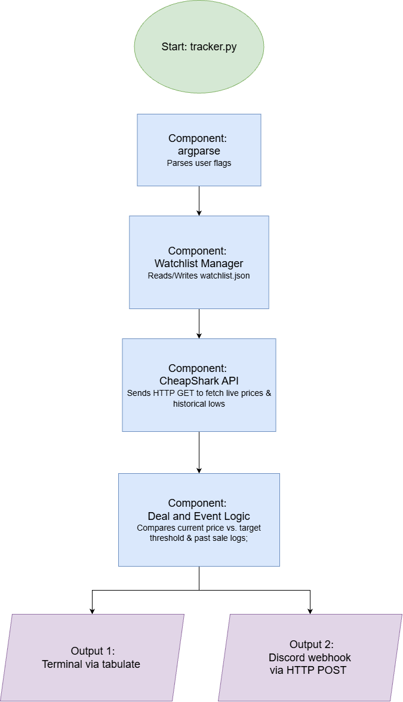

# Steam Deal Tracker

A Python command-line tool that tracks and compares live Steam discounts against historical sale lows, and sends automated Discord webhook alerts for upcoming seasonal sales and price drops.

## MVP Scope
- Add, remove, and view desired Steam games and price thresholds in a local `watchlist.json` file
- Query the CheapShark API to compare a game's sale price against its historical lowest sale price
- Check a calendar of major Steam sales and send notifications

## The Problem

Whenever major Steam events like the Winter Sale or Summer Sale happen, I often forget to check the store until the event is over, and when I do see a discount, Steam never tells me how the current sale price compares to past sales. A game might advertise "40% off," making it look like a great deal, when it actually sold for 75% off during an older sale a few months ago. 

## How It Works

The script loads your tracked games from a local JSON storage file, queries the public CheapShark API to fetch live pricing and historical lows, evaluates the numbers against your target budget thresholds, checks upcoming Steam seasonal dates via local timestamps, and outputs formatted tables directly to your terminal while pushing instant notifications to a personal Discord channel.

## Tech Stack

- **Language:** Python 3
- **Libraries & Commands:**
  - `requests` (library): Sends HTTP `GET` requests to the API (with required custom `User-Agent` headers) and HTTP `POST` requests to the Discord webhook URL.
  - `json` (Python): Reads and writes data into a local `watchlist.json` file.
  - `argparse` (Python): Parses command-line arguments.
  - `datetime` (Python): Compares the current date against upcoming sale dates and converts API Unix timestamps.
  - `tabulate` (library): Formats terminal output into a clean table.
- **Data Storage:** A local `watchlist.json` file.
- **External Data Sources:**
  - **CheapShark API** ([https://www.cheapshark.com/api/1.0/games](https://www.cheapshark.com/api/1.0/games)): Completely free, public, requires no API key, and returns standard JSON. It is accessed in two steps:
    1. Query `?title=<game_name>&limit=1` to get the game's CheapShark `gameID`, `steamAppID`, and current cheapest price.
    2. Query `?id=<gameID>` to get the retail price, active Steam deal, and `cheapestPriceEver`.

## Author

Colin Hsiao, (https://github.com/colinthsiao49)